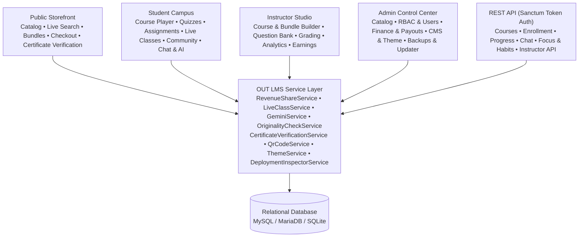

<p align="center">
  
</p>

<h1 align="center">OUT LMS — The Open University of Tanzania Learning Management System</h1>

<p align="center">
  <strong>Open and online learning &bull; Affordable and quality education for all &bull; Blended &amp; digital instruction</strong>
</p>

<p align="center">
  
  
  
  
</p>

<p align="center">
  
  &nbsp;
  <em>Institutional Digital Campus, Course Delivery, Assessment, Certification &amp; Academic Operations Platform</em>
  &nbsp;
  
</p>

---

## Table of Contents

1. [Executive Overview](#executive-overview)
2. [Brand Identity, Logos & Icons](#brand-identity-logos--icons)
3. [System Architecture & Portals](#system-architecture--portals)
4. [Comprehensive Feature Breakdown](#comprehensive-feature-breakdown)
   - [Public Storefront & Direct Course Enrollment](#1-public-storefront--direct-course-enrollment)
   - [Student Campus Portal](#2-student-campus-portal)
   - [Instructor Studio Portal](#3-instructor-studio-portal)
   - [Admin Control Center](#4-admin-control-center)
   - [Payment Gateways & Revenue Sharing](#5-payment-gateways--revenue-sharing)
   - [REST API for Web & Mobile Clients](#6-rest-api-for-web--mobile-clients)
   - [Security, Operations & CI/CD Maintenance](#7-security-operations--cicd-maintenance)
5. [Technology Stack](#technology-stack)
6. [Directory Structure](#directory-structure)
7. [Installation, Configuration & Local Development](#installation-configuration--local-development)
8. [Seeded Accounts & Security Hygiene](#seeded-accounts--security-hygiene)
9. [Maintenance & License](#maintenance--license)

---

## Executive Overview

**OUT LMS** is the institutional e-learning and academic delivery platform designed for **The Open University of Tanzania (OUT)** and maintained by **Wolinet**. Built on a modular MVC and service-oriented PHP architecture (`^8.3`), OUT LMS unifies public course discovery, single-course and bundle checkout, interactive lesson delivery, live classrooms, plagiarism-aware assignment grading, automated PDF/QR certification, and administrative operations in a single cohesive codebase.

### Architectural Design Principles

- **Direct Per-Course & Bundle Enrollment**: Learners browse courses and curated bundles and enroll or purchase directly per course without recurring subscription locks or tier gates.
- **Role-Isolated Multi-Portal Experience**: Dedicated interfaces for **Public Learners**, **Student Campus**, **Instructor Studio**, and **Admin Control Center**, backed by granular role and permission controls.
- **Centralized Institutional Branding**: Dynamic helpers (`site_name()`, `site_tagline()`, `branding_asset()`) inject **OUT LMS** metadata, Open Graph cards, favicons, Apple touch icons, and custom logos across every portal, email template, and PDF certificate.
- **Zero-Touch Post-Deploy Governance**: Built-in deployment inspection (`DeploymentInspectorService`), automated database/storage backups (`SystemBackupService`), application log inspection, and guided web setup installer.

---

## Brand Identity, Logos & Icons

OUT LMS ships with standardized visual assets under `public/` and supports dynamic runtime overrides through **Admin Settings &rarr; Branding** (`admin.settings.branding`):

| Asset Role | Default Path | Fallback / Purpose |
| --- | --- | --- |
| **Primary Brand Logo** | `public/assets/front/img/logo/brand-logo-v3.png` | Navbar headers, Open Graph previews, emails, portal headers |
| **Primary Logo Alias** | `public/assets/front/img/logo/logo.png` | Default front-end & portal logo fallback |
| **Dark / Light Logos** | `public/assets/front/img/logo/logo-dark.png`, `black-logo.svg`, `white-logo.svg` | Theme-adaptive headers and dark/light sidebars |
| **Primary Favicon (PNG)** | `public/assets/front/img/logo/brand-favicon-v3.png` | Browser tab icons across Public, Auth, Student, Instructor, Admin & Setup shells |
| **Vector & Legacy Favicons** | `public/assets/front/img/favicon.svg`, `public/assets/front/img/favicon.png`, `public/favicon.ico` | Vector browser icon and root `.ico` support |
| **Apple Touch Icon** | `public/apple-touch-icon.png` | iOS/iPadOS home screen & PWA shortcut icon (`180x180`) |
| **Institutional Colors** | `#013BA6` (Deep Blue), `#228DDD` (Sky Blue), `#F4ED2D` (Gold Accent) | Browser `<meta name="theme-color">`, buttons, cards, and auth layouts |

<p align="center">
  
  &nbsp;&nbsp;&nbsp;&nbsp;
  
  &nbsp;&nbsp;&nbsp;&nbsp;
  
</p>

---

## System Architecture & Portals



---

## Comprehensive Feature Breakdown

### 1. Public Storefront & Direct Course Enrollment
- **Course Catalog & Instant Live Search**: Filter published courses by category, instruction language, difficulty level, price, and rating, paired with instant AJAX live-search results (`CoursesController::liveSearch`) with safe thumbnail fallbacks.
- **Course Bundles**: Showcase and sell curated multi-course learning pathways via `BundleController`.
- **Single-Course Checkout & Enrollment**: Seamless enrollment workflow for free and paid courses/bundles (`CourseEnrollmentController`), supporting promotional coupon validation (`CouponService`) and multi-gateway payment callbacks.
- **Instructor Showcase & Learner Feedback**: Public instructor profile pages, verified course ratings, student reviews, and curated institutional testimonials.
- **Public Certificate Verification**: Anyone (employers, registrars, institutions) can verify issued OUT LMS certificates using the certificate verification code or QR code (`CertificateVerificationController`, `CertificateVerificationService`).
- **Institutional Information & Lead Capture**: Dynamic About, Contact (with configurable notification routing), FAQs, Newsletter subscription, and admin-defined custom CMS pages.

### 2. Student Campus Portal
- **Campus Dashboard**: Unified overview of active courses, progress summaries, upcoming live classes, pending assignments, and recent notifications.
- **Interactive Course Player**: Multi-format lesson player (`StudentCourseController`) featuring custom HTML5 video playback controls (rewind/forward 10s, playback speed selector, Picture-in-Picture), downloadable lesson attachments, lesson completion tracking, and drip-schedule enforcement.
- **Quizzes & Assignments**: Interactive quiz engine with timed attempts, instant score feedback, attempt history, and structured assignment submission (`AssignmentsController`, `QuizAttemptsController`).
- **Live Class Integration**: View upcoming sessions and launch live classroom meetings directly from the student workspace (`LiveClassController`, `LiveClassService`).
- **Certificates & Billing History**: Download branded OUT LMS PDF certificates upon course completion and review personal enrollment/payment records.
- **Collaboration, AI & Support**:
  - **Course Discussions**: Per-course Q&A threads with instructors and peers.
  - **Direct Messaging**: Private student–instructor chat (`ChatService`).
  - **AI Study Assistant**: Gemini-powered conversational study assistant (`AiChatController`, `GeminiService`).
  - **Campus Community**: Peer Q&A forum for technical and academic discussions.
  - **Support Tickets & Profile Settings**: Dedicated helpdesk ticket workflow, notification preferences, OTP/password management, and account settings.

### 3. Instructor Studio Portal
- **Visual Course & Bundle Builder**: Full curriculum authoring (`CourseBuilderController`) supporting modules/topics, video/document/text lessons, YouTube playlist importing (`YouTubePlaylistService`), attachments, prerequisite sequencing, and course bundles.
- **Question Bank & Assessment Authoring**: Reusable question bank (`QuestionBankController`) mapped to quizzes, automated grading for objective items, and manual review queues for quiz attempts.
- **Assignment Review & Originality Checks**: Inspect student submissions, provide rubric feedback/grades, and run automated originality verification (`OriginalityCheckService`).
- **Live Class Scheduling**: Create, update, and host synchronous sessions via `LiveClassController` & `LiveClassService`.
- **Cohort Analytics & Student Roster**: Track course enrollments, lesson completion rates, quiz performance, and direct learner engagement.
- **Monetization, Co-Instructors & Coupons**: Configure instructor-scoped discount coupons, track co-instructor splits (`RevenueShareService`), review net earnings, and submit withdrawal requests.

### 4. Admin Control Center
- **Course & Academic Oversight**: Approve, publish, archive, or moderate courses, course bundles, categories, instruction languages, enrollments, quiz attempts, and assignment submissions.
- **Users, Roles & Staff Governance**: Full CRUD for Students, Instructors, Staff, and Administrators backed by granular RBAC permission matrices, instructor onboarding approval queues, account deletion request handling (`AccountDeletionService`), and secure admin user impersonation (`ImpersonationController`).
- **Finance, Gateways & Reporting**: Activate/configure payment providers (`PaymentGatewayController`), approve offline manual payments, review withdrawal payouts, audit transactions, and export PDF/Excel financial and academic reports (`ReportsController`).
- **Drag-and-Drop Certificate Studio**: Visual certificate template designer (`CertificateTemplateController`) pre-configured for **The Open University of Tanzania**, supporting custom backgrounds, dynamic placeholders (learner name, course title, date, serial code, QR verification badge), and multi-template management.
- **Frontend, Theme & Navigation CMS**: Manage homepage hero/sections, promotional banners, navigation menus & menu items, announcement marquee, About/Contact/FAQ pages, custom CMS pages, theme styling (`ThemeService`), SEO metadata, and multi-language translation dictionaries (`LanguageManagerService`).
- **System Maintenance, Backups & Post-Deploy Updater**:
  - **CI/CD Git Deployment & Updater (`UpdaterController`, `DeploymentInspectorService`)**: Inspect deployed Git commit status, pending migrations, version state, and post-deployment synchronization checks after CI/CD rollouts.
  - **Backups (`BackupController`, `SystemBackupService`)**: Create, list, download, and restore system/database backups directly from the admin panel.
  - **System Health & Logs (`SystemMaintenanceController`)**: Cache clearing, environment diagnostics, cron scheduler instructions, activity auditing, and integrated log inspection.

### 5. Payment Gateways & Revenue Sharing
OUT LMS includes an extensible gateway abstraction (`PaymentGatewayService`) paired with automated instructor/platform revenue splitting (`RevenueShareService`):

| Category | Supported Gateways & Flows |
| --- | --- |
| **Global Cards & Wallets** | Stripe (`stripe/stripe-php`), PayPal, Mollie, XPay |
| **African & Regional Gateways** | Paystack (`yabacon/paystack-php`), Flutterwave, Razorpay |
| **South Asian Gateways** | SSLCommerz, bKash |
| **Institutional / Manual** | Offline bank transfer / receipt submission with Admin approval queue |

### 6. REST API for Web & Mobile Clients
Token-authenticated endpoints (`Sanctum`) located under `app/Http/Controllers/Api/`:
- **Auth & Profile**: Registration, login, profile updates, password changes, notifications, app configuration.
- **Discovery & Checkout**: Home feed, course catalog, bundles, single-course enrollment, coupon validation, payments.
- **Learning & Credentials**: Student dashboard, lesson progression, course discussions, live classes, certificates, certificate verification.
- **Campus Engagement & Productivity**: Community Q&A, real-time chat, file uploads, support tickets, plus student **Focus Timer** (`FocusController`) and **Habit Tracker** (`HabitController`) endpoints.
- **Instructor API Suite**: Dedicated `Api/Instructor/*` controllers for managing courses, students, analytics, and assessments remotely.

### 7. Security, Operations & CI/CD Maintenance
- **Authentication & 2FA**: Powered by Fortify with email verification, OTP support (`OtpService`), Google reCAPTCHA (`RecaptchaService`), and password reset flows.
- **Cookie Consent & Privacy**: GDPR/institutional cookie compliance banner and user-initiated account deletion workflows.
- **Guided Web Installer**: Browser-based setup wizard (`resources/views/setup/`, `app/Services/Installer/`) checking PHP extensions, directory permissions, database connectivity, and initial environment setup.

---

## Technology Stack

| Layer | System Components & Capabilities |
| --- | --- |
| **Runtime** | PHP `^8.3 \| ^8.4 \| ^8.5` |
| **Core & Authentication** | Modular MVC Core, Fortify Auth & 2FA, Sanctum Token API |
| **Frontend & UI** | Vite `^7.0.7`, Tailwind CSS `^4.0.0`, Bootstrap 4/5, Axios `^1.11` |
| **Access & Auditing** | Role-Based Access Control (RBAC), System Activity Auditing |
| **Documents & Export** | DomPDF / FPDF Certificate Rendering, Image Processing, Excel & Spreadsheet Export |
| **Payments & Alerts** | Stripe, Paystack, PayPal, Razorpay, Flutterwave, Mollie, SSLCommerz, bKash, XPay, Toast Notifications |
| **Observability & Testing** | Integrated Log Viewer, PHPUnit (`^11.5`), Pint Code Styling |

---

## Directory Structure

```text
out-lms/
├── app/
│   ├── Actions/               # Authentication & profile action handlers
│   ├── Http/
│   │   ├── Controllers/
│   │   │   ├── Admin/         # Admin dashboard, catalog, finance, CMS, backups & updater
│   │   │   ├── Api/           # Sanctum REST API endpoints (Student, Public, Instructor)
│   │   │   ├── Front/         # Public catalog, live search, bundles, checkout & CMS pages
│   │   │   ├── Instructor/    # Course builder, question bank, grading, analytics & earnings
│   │   │   └── Student/       # Course player, quizzes, assignments, live classes & community
│   │   ├── Middleware/        # Auth, RBAC, maintenance, setup & localization middleware
│   │   └── Requests/          # Form validation classes
│   ├── Models/                # Domain entities (Course, Enrollment, Bundle, Payment, Certificate, etc.)
│   ├── Services/              # Business logic (RevenueShare, Gemini, OriginalityCheck, Backup, Theme, etc.)
│   └── Support/               # Global branding & configuration helpers (site_name, branding_asset)
├── config/                    # Application, database, auth, payment & permission configurations
├── database/
│   ├── migrations/            # Schema definitions
│   └── seeders/               # AdminSeeder, PlatformSettingSeeder, DemoContentSeeder, etc.
├── public/
│   ├── apple-touch-icon.png   # OUT LMS 180x180 touch icon
│   ├── favicon.ico            # OUT LMS root favicon
│   └── assets/
│       ├── admin/             # Admin panel assets & styles
│       └── front/img/logo/    # OUT LMS logos (brand-logo-v3.png, brand-favicon-v3.png, SVGs)
├── resources/
│   ├── views/                 # Blade templates (layouts, storefront, student, instructor, admin, setup, emails)
│   ├── css/ & js/             # Vite-managed Tailwind CSS & JS entrypoints
│   └── lang/                  # Localization files
└── routes/                    # Web, Portal, Admin, Setup & API route definitions
```

---

## Installation, Configuration & Local Development

### Prerequisites
- **PHP** `8.3`, `8.4`, or `8.5` with `bcmath`, `ctype`, `curl`, `dom`, `fileinfo`, `gd`/`imagick`, `json`, `mbstring`, `openssl`, `pdo_mysql` (or `pdo_sqlite`), `tokenizer`, `xml`, `zip`
- **Composer** `2.x`
- **Node.js** `18+` & **npm**
- **Database**: MySQL `8.0+` / MariaDB `10.6+` (or SQLite for lightweight local evaluation)

### Step-by-Step Setup

1. **Clone the repository**
   ```bash
   git clone https://github.com/wolinet-renatus/edux.git
   cd edux
   ```

2. **Run the automated setup pipeline**
   ```bash
   composer setup
   ```
   This installs PHP dependencies, creates `.env` from `.env.example` if absent, generates `APP_KEY`, runs database migrations, installs npm packages, and compiles production assets via Vite.

3. **Configure environment variables (`.env`)**
   Verify institutional branding, application URL, and database/mail settings:
   ```env
   APP_NAME="OUT LMS"
   APP_ENV=local
   APP_DEBUG=true
   APP_URL=http://localhost:8000

   DB_CONNECTION=mysql
   DB_HOST=127.0.0.1
   DB_PORT=3306
   DB_DATABASE=edux
   DB_USERNAME=root
   DB_PASSWORD=
   ```

4. **Link storage & seed initial data**
   ```bash
   php artisan storage:link
   php artisan migrate --seed
   ```

5. **Launch local development services**
   ```bash
   composer dev
   ```
   Starts the local web server, background queue listener, and Vite hot-reload server concurrently. To build frontend bundles separately:
   ```bash
   npm run build
   ```

6. **Configure background scheduler (Production)**
   Add the system cron entry so queued emails, live class reminders, and scheduled tasks execute reliably:
   ```cron
   * * * * * cd /path/to/edux && php artisan schedule:run >> /dev/null 2>&1
   ```

7. **Run the automated test suite**
   ```bash
   composer test
   ```

---

## Seeded Accounts & Security Hygiene

When running `AdminSeeder` (defined in `config/demo_accounts.php`), the following default RBAC role accounts are provisioned for local testing and onboarding (`password` for all):

| Portal Role | Scope / Isolation | Email | Password |
| --- | --- | --- | --- |
| **Super Admin** | Cross-Branch (`manage-all`) | `superadmin@lsmout.ac.tz` | `password` |
| **Administrator** | Cross-Branch (`manage-all`) | `admin@lsmout.ac.tz` | `password` |
| **System Administrator** | Cross-Branch (Security & IT) | `sysadmin@lsmout.ac.tz` | `password` |
| **Director** | Cross-Branch Executive | `director@lsmout.ac.tz` | `password` |
| **Deputy Director** | Cross-Branch Oversight | `deputy.director@lsmout.ac.tz` | `password` |
| **Marketing Officer** | Cross-Branch Growth | `marketing@lsmout.ac.tz` | `password` |
| **Branch Manager** | Isolated (`OUT Headquarters`) | `branch.manager@lsmout.ac.tz` | `password` |
| **Coordinator** | Isolated (`Singida Regional Center`) | `coordinator@lsmout.ac.tz` | `password` |
| **Accountant** | Isolated (`OUT Headquarters`) | `accountant@lsmout.ac.tz` | `password` |
| **Staff** | Isolated (`OUT Headquarters`) | `staff@lsmout.ac.tz` | `password` |
| **Tutor / Instructor** | Isolated (`/instructor/*` portal) | `instructor@lsmout.ac.tz` | `password` |
| **Student** | Isolated (`/student/*` portal) | `student@lsmout.ac.tz` | `password` |

> [!WARNING]
> Immediately update all seeded passwords, enforce strong `APP_KEY` entropy, set `APP_DEBUG=false`, and restrict `.env` permissions before exposing any environment to public networks.

---

## Maintenance & License

- **Maintained By**: **Wolinet** for **The Open University of Tanzania (OUT LMS)**
- **License**: Released under the [MIT License](https://opensource.org/licenses/MIT).
