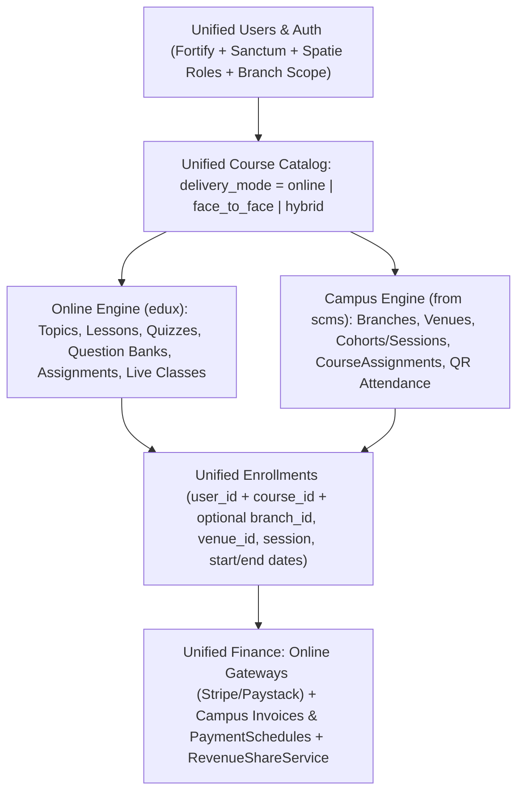

# Unified University Learning & Short Course Management System (`edux` + `scms`)

## 1. Feasibility & Possibility Assessment

**Verdict: 100% Possible and Strategically Ideal.**

Merging **`edux`** (Online Learning Management System) and **`scms`** (Short Course Management System for Face-to-Face / Campus Delivery) into **one uniform codebase** is technically straightforward because both projects share the same core stack:

| Dimension | `edux` (Online LMS) | `scms` (Face-to-Face / Short Courses) | Unified Target (`edux` Core) |
| :--- | :--- | :--- | :--- |
| **Framework** | Laravel `^13.0` (PHP `^8.3+`) | Laravel `^13.0` (PHP `^8.3+`) | Single Laravel `^13.0` codebase |
| **Database** | MySQL (`edux`) | MySQL (`scms`) | Single unified MySQL database |
| **Frontend** | Blade + Bootstrap 4/5 + Stisla Admin | Blade + Bootstrap + Vite | Unified Blade portals (Admin, Instructor/Tutor, Student) |
| **Auth & API** | Laravel Fortify + Sanctum | Laravel UI + Sanctum | Fortify + Sanctum (Web + Mobile/API) |
| **Roles & Access** | `spatie/laravel-permission` (`admin`, `instructor`, `student`) | Custom `RolePermission`, `UserPermission`, `BranchScoped` trait | `spatie/laravel-permission` + `BranchScoped` trait |
| **Course Model** | `Course`, `CourseTopic`, `Lesson`, `Quiz`, `QuestionBank`, `Assignment`, `LiveClass` | `Course` (`title`, `fee`, `duration`, `has_discount`, `discount`) | Unified `Course` with `delivery_mode` (`online`, `face_to_face`, `hybrid`) |
| **Enrollment Model** | `Enrollment` (`user_id`, `course_id`, progress, status) | `Enrollment` (`applicant_id`, `course_id`, `venue_id`, `session`, `start_date`, `end_date`, `fee`) | Unified `Enrollment` supporting both online progress and campus cohort metadata |
| **Billing & Payouts** | `Payment`, `RevenueShareService`, `CourseCoInstructor`, Stripe/Paystack, Withdrawals | `Invoice` (`invoice_prefix`, unpaid/paid/partial), `Payment`, `PaymentSchedule` (installments) | Online checkout + Campus `Invoice` & `PaymentSchedule` + `RevenueShareService` |
| **Campus & Ops** | Live Zoom / Google Meet | `Branch`, `Venue`, `Tutor`, `CourseAssignment` (room + date + time), QR / PDF reports | Full campus scheduling + online classroom under one roof |

### Why a Single Uniform Codebase Works Best
1. **Shared Identity (`users`):** Students, instructors/tutors, branch coordinators, and university admins log into **one portal** with one set of credentials. A student can take an online prerequisite, attend a physical campus workshop, and receive one unified transcript/certificate.
2. **Zero Duplicate Maintenance:** One deployment pipeline, one database backup, one notification engine, and one reporting dashboard for university leadership covering both online and face-to-face revenue, enrolments, and completion.
3. **Why Not Copy-Paste Directly:** Both systems have colliding table names (`users`, `courses`, `enrollments`, `payments`) with different columns. Attempting to merge files without schema unification would break migrations and relationships. Instead, **`edux` becomes the core platform** and **`scms` domain modules are ported cleanly as additive migrations, models, services, and controllers**.

---

## 2. Target Unified Architecture

### Delivery Modes (`courses.delivery_mode`)
- **`online`**: Uses `edux` curriculum (topics, video/text lessons, quizzes, question banks, assignments, Zoom/Google Meet live classes, drip content, AI Course Builder).
- **`face_to_face`**: Uses `scms` campus operations (Branch, Venue/Room, Cohort `session`, `start_date`/`end_date`, `CourseAssignment` timetable, physical attendance, campus `Invoice` + `PaymentSchedule` installments).
- **`hybrid`**: Combines both — physical venue schedule (`CourseAssignment`) **plus** online LMS materials, quizzes, and assignments in `edux`.

---

## 3. Database & Schema Unification Plan

### 3.1 Extend Existing `edux` Tables
1. **`users`:**
   - Add `branch_id` (`nullable`, FK -> `branches.id`) for branch admins, coordinators, and campus tutors.
   - Add `phone`, `registration_number` / `national_id` (for `scms` applicant/student parity).
2. **`courses`:**
   - Add `delivery_mode` (`enum('online', 'face_to_face', 'hybrid')`, default `'online'`).
   - Add `duration_label` (`string`, nullable, e.g. `"4 Weeks"` from `scms`).
   - Add `has_discount` (`boolean`, default `false`), `discount_amount` (`decimal(10,2)`, nullable) or map into `regular_price` / `sale_price`.
3. **`enrollments`:**
   - Add `branch_id` (`nullable`, FK -> `branches.id`)
   - Add `venue_id` (`nullable`, FK -> `venues.id`)
   - Add `session` (`string`, nullable, e.g. `"Morning"`, `"Evening"`, `"Cohort Jan 2027"`)
   - Add `start_date` (`date`, nullable) and `end_date` (`date`, nullable)
   - Add `agreed_fee` (`decimal(10,2)`, nullable) and `delivery_mode` (`string`, default `'online'`)
4. **`payments`:**
   - Add `invoice_id` (`nullable`, FK -> `invoices.id`) so installment and campus payments reconcile directly with `edux` payments and `RevenueShareService`.

### 3.2 Port `scms` Domain Tables into `edux`
Create clean additive migrations in `edux`:
1. **`branches`**: `id`, `name`, `location`, `code`, `is_active`, `timestamps` (from `scms` `Branch`).
2. **`venues`**: `id`, `branch_id` (FK), `name`, `capacity`, `room_type`, `timestamps` (from `scms` `Venue`).
3. **`course_assignments`** (Campus Timetable / Instructor-Room Allocation): `id`, `branch_id`, `venue_id`, `course_id`, `instructor_id` (FK -> `users.id`), `date`, `start_time`, `end_time`, `active`, `is_taught`, `timestamps` (from `scms` `CourseAssignment`).
4. **`applicants`** (Intake / Walk-in & Offline Applications): `id`, `user_id` (nullable FK -> `users.id` created on intake), `branch_id`, `full_name`, `email`, `phone`, `country_id`, `sponsor_type` (`self`, `organization`, `staff_discount`), `status`, `timestamps`.
5. **`invoices`**: `id`, `invoice_prefix` (unique), `enrollment_id` (FK), `user_id` (FK), `branch_id` (FK), `subtotal`, `discount_amount`, `total_amount`, `paid_amount`, `balance`, `status` (`unpaid`, `paid`, `partial`), `due_date`, `softDeletes`, `timestamps`.
6. **`payment_schedules`** (Installment Plans): `id`, `invoice_id` (FK), `installment_number`, `due_date`, `amount`, `status` (`pending`, `reminded`, `paid`, `overdue`), `sent_at`, `paid_at`, `payment_id` (nullable FK), `notes`, `timestamps`.
7. **`classroom_attendances`** (New unified attendance table): `id`, `course_assignment_id` (FK), `enrollment_id` (FK), `user_id` (FK), `checked_in_at`, `method` (`qr`, `manual`), `marked_by`, `timestamps`.

---

## 4. Roles, Permissions & Multi-Branch Access Control

- **Unify on `spatie/laravel-permission` (already in `edux`):**
  - Core roles: `super_admin` / `admin` (global cross-branch visibility), `branch_admin` (scoped to assigned `branch_id`), `instructor` (covers both online instructors and `scms` tutors, with `can_edit` co-instructors & assistants), `accountant` (invoices & payment schedules), and `student`.
- **Port `BranchScoped` Trait from `scms`:**
  - Apply `BranchScoped` to `Enrollment`, `Invoice`, `PaymentSchedule`, `CourseAssignment`, and `Applicant`.
  - Users with `admin` / `super_admin` see all branches; `branch_admin` and branch-assigned staff see only records matching `auth()->user()->branch_id`.

---

## 5. Feature Integration Matrix

### 5.1 Course Builder & Catalog (`edux` Admin + Instructor)
- Extend `course-builder.blade.php` and `CourseBuilderController`:
  - Add **Delivery Mode** selector: `Online`, `Face-to-Face`, `Hybrid`.
  - When `Face-to-Face` or `Hybrid` is chosen, show **Branch & Venue** assignment, **Cohort Dates & Session**, and **Timetable Slots (`CourseAssignment`)** right inside the builder.
  - Keep all existing `edux` features (AI Course Builder, AI Studio, YouTube Playlist Import, Question Banks, Merit Lists, Assignments + Originality Check, Co-instructors + Revenue Share).

### 5.2 Campus Intake, Invoicing & Installments (from `scms`)
- **Walk-in / Registrar Intake:** Branch admins can register an applicant (`ApplicantController`), automatically link/create their `User` account (`role = student`), create their `Enrollment` (with `branch_id`, `venue_id`, `session`, `start_date`, `end_date`), and generate an `Invoice` + optional `PaymentSchedule` installments.
- **Online Checkout:** Students enrolling online through `edux` still pay via Stripe/Paystack (or generate an invoice for bank transfer / campus payment), with `RevenueShareService` handling primary + co-instructor splits.
- **PDF Receipts, Invoices & Transcripts:** Port `scms` DomPDF / FPDF invoice & report templates into `edux` (`barryvdh/laravel-dompdf` is already installed in `edux`).

### 5.3 Classroom Attendance & Certificates
- Add QR code generation (`simplesoftwareio/simple-qrcode`) for each `CourseAssignment` session so face-to-face students can scan to check in, or tutors can mark attendance manually.
- Certificate issuance checks **both** criteria based on `delivery_mode`:
  - `online`: Lesson/quiz/assignment completion.
  - `face_to_face`: Attendance threshold + `Invoice` balance `== 0` (cleared tuition, matching `scms` rules).
  - `hybrid`: Both online completion and campus attendance/tuition clearance.

---

## 6. Step-by-Step Execution Roadmap

### Phase 1: Dependencies & Foundation (1–2 days)
1. Standardize PHP (`^8.3`) and align Laravel packages in `edux/composer.json` (add `simplesoftwareio/simple-qrcode`, `maatwebsite/excel`, `spatie/laravel-activitylog` if needed).
2. Create the additive database migrations for `branches`, `venues`, `course_assignments`, `applicants`, `invoices`, `payment_schedules`, `classroom_attendances`, and column additions on `users`, `courses`, `enrollments`, `payments`.
3. Create corresponding Eloquent models and the `BranchScoped` trait in `edux/app/Traits/BranchScoped.php`.

### Phase 2: Campus & Timetable Modules (2–3 days)
1. Port `BranchController`, `VenueController`, and `CourseAssignmentController` into `edux/app/Http/Controllers/Admin/` under `admin.campus.*` routes.
2. Add Branch/Venue/Session/Timetable fields to `CourseBuilderController` and `course-builder.blade.php` driven by `delivery_mode`.
3. Add `branch_id` scoping to Admin and Instructor queries where applicable.

### Phase 3: Unified Intake, Invoices & Payment Schedules (2–3 days)
1. Port `ApplicantController`, `InvoiceController`, and `PaymentScheduleController` into `edux`.
2. Connect `Invoice` payment recording to `edux`'s `Payment` model and `RevenueShareService` so campus payments also update instructor/co-instructor ledgers accurately.
3. Add automated installment due-date reminder commands (from `scms` `PaymentSchedule`).

### Phase 4: Unified Student & Tutor Portals + Attendance (2 days)
1. Update `edux` Student Dashboard (`student/courses`) to show:
   - **Online / Hybrid** courses: "Continue Learning" button (lessons, quizzes, live classes).
   - **Face-to-Face / Hybrid** courses: Campus, Venue/Room, Timetable (`CourseAssignment`), Attendance %, and Invoice/Installment status.
2. Add QR & manual classroom attendance for instructors/tutors.

### Phase 5: Historical Data Migration (`scms` -> `edux`) (1–2 days)
1. Configure a read-only `scms` secondary connection in `config/database.php`.
2. Build an idempotent Artisan command `php artisan scms:import`:
   - Import `branches` & `venues`.
   - Import `scms.courses` into `edux.courses` with `delivery_mode = 'face_to_face'`.
   - Map `scms.users` & `scms.tutors` & `scms.applicants` into `edux.users` (deduplicated by email/phone, preserving roles and `branch_id`).
   - Import `scms.enrollments`, `scms.course_assignments`, `scms.invoices`, `scms.payments`, and `scms.payment_schedules` preserving foreign-key mappings.
3. Run row-count and financial-total reconciliation (`SUM(invoices.total_amount)`, `SUM(payments.amount)`).

### Phase 6: Verification & Cutover (1–2 days)
1. Test all 3 delivery modes (`online`, `face_to_face`, `hybrid`) end-to-end: registration, enrollment, invoice/installment payment, online quiz/assignment, campus attendance, and certificate generation.
2. Verify `BranchScoped` isolation so Branch A staff cannot view Branch B applicants/invoices.
3. Decommission standalone `scms` writes and point the university domain to the unified `edux` codebase.

---

## 7. Risks & Mitigations

| Risk | Mitigation |
| :--- | :--- |
| **Duplicate Users (`scms` applicants vs `edux` students)** | Deduplicate by normalized `email` and standardized `phone` during `scms:import`; keep a `legacy_scms_id` mapping column during transition. |
| **Laravel Version Difference (`edux` v12 vs `scms` v13)** | Port `scms` domain code into `edux` (rather than merging `vendor/`), or upgrade `edux` to Laravel 13 first; PHP 8.3 is already running in MAMP. |
| **Financial Discrepancies (Online vs Installment Ledger)** | Route all recorded `Invoice` payments through a single `Payment` record linked via `invoice_id` so reports reconcile from one table. |
| **Permission Leakage Across Branches** | Enforce `BranchScoped` global scope + controller policy checks on every campus/invoice endpoint, verified by automated tests. |

